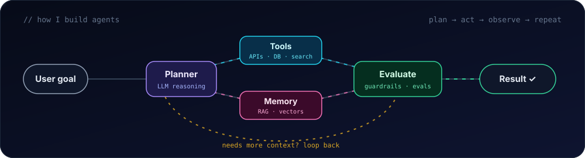

<a href="https://github.com/devstar829">
  
</a>

<p align="center">
  <sub><code>ai agents</code> · <code>llm apps</code> · <code>rag</code> · <code>mcp</code> · <code>healthcare tech</code> · <code>data pipelines</code> · <code>cloud-native</code></sub>
</p>

### `> cat about.md`

I turn messy, real-world problems into working products. Right now I'm focused on **LLM-powered apps and agentic systems**: software that plans, calls tools and finishes the job instead of only answering questions.

```yaml
role:      full-stack + AI engineer
building:  tool-using agents · RAG systems · healthcare platforms · ETL pipelines
exploring: multi-agent orchestration · MCP servers · LLM evaluation
values:    clean code · shipping fast · humans in the loop for high-stakes calls
status:    open to remote roles & collaborations
```

<br/>



<br/><br/>



<br/>

### `> ls ~/projects --featured`

<p align="center">
  <a href="https://github.com/devstar829/Telehealth_Platform"></a>
  <a href="https://github.com/devstar829/ChatBot-LangChain"></a>
  <a href="https://github.com/devstar829/Diabetes-risk-prediction"></a>
  <a href="https://github.com/devstar829/DatapipeLine-S3-to-Redshift-AirFlow"></a>
  <a href="https://github.com/devstar829/VideoStreaming_Django"></a>
  <a href="https://github.com/devstar829/Node.JS-Real-Time-Medication-Reminder-System"></a>
</p>

<details>
<summary><b>More builds</b>: microservices, games &amp; challenges</summary>
<br/>

| Project | What it is |
|:--|:--|
| [tictactoe](https://github.com/devstar829/tictactoe) | AI opponent on Spring Boot + RabbitMQ microservices |
| [tictactoe-2](https://github.com/devstar829/tictactoe-2) | Redis + OAuth 2.0 + Spring Boot microservice |
| [tictactoe_frontend](https://github.com/devstar829/tictactoe_frontend) | React client for the tictactoe services |
| [AlertEngine](https://github.com/devstar829/AlertEngine) | Concurrent alerting engine in Java with threads |
| [Challenge_SpringBoot-Docker](https://github.com/devstar829/Challenge_SpringBoot-Docker) | Web service built to a documented API, containerized |
| [FastAPI](https://github.com/devstar829/FastAPI) | Python API experiments with FastAPI |

</details>

<br/>

### `> git log --graph --all`

<picture>
  <source media="(prefers-color-scheme: dark)" srcset="https://raw.githubusercontent.com/devstar829/devstar829/output/snake-dark.svg" />
  <source media="(prefers-color-scheme: light)" srcset="https://raw.githubusercontent.com/devstar829/devstar829/output/snake.svg" />
  
</picture>

<p align="center">
  <sub>✦ Building agents that finish the job ✦</sub>
</p>
