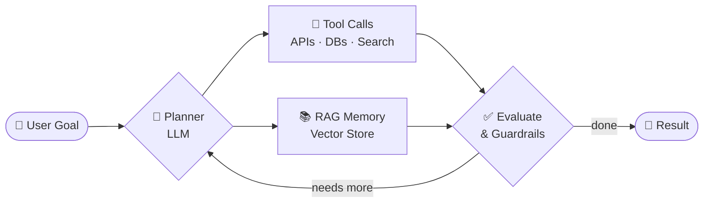

<!-- ============================== HEADER ============================== -->

<h1>Roilan Roman</h1>
<h3>Full-Stack · AI &amp; Agentic Systems · Data Engineering</h3>

 

---

## 👋 About Me

I'm a **full-stack and AI engineer** who turns messy, real-world problems into working products. My focus today is building **LLM-powered applications and agentic systems**: software that doesn't just answer questions, but plans, calls tools, and gets work done.

- 🤖 Designing **AI agents** with tool use, memory, and multi-step reasoning
- 🏥 Building **healthcare tech**: telehealth platforms, risk prediction, medication reminders
- 🔄 Engineering **data pipelines** on AWS (S3 → Redshift with Airflow)
- ☁️ Shipping **cloud-native** services with Docker, Kubernetes, and CI/CD
- 🌱 Currently exploring: **multi-agent orchestration, MCP servers, and evaluation of LLM apps**

> 💡 *"The best software in the AI era isn't a chatbot. It's an agent that finishes the job."*

---

## 🤖 AI & Agentic Toolkit

The stack I use to build modern AI products:

| Layer | Tools & Concepts |
|:------|:-----------------|
| 🧠 **Foundation Models** |     |
| 🕸️ **Agent Frameworks** |     |
| 🔌 **Tools & Protocols** |    |
| 📚 **RAG & Memory** |     |
| 🧪 **ML & Vision** |     |
| ⚙️ **AI-Assisted Dev** |    |

### 🧭 How I Build Agents

- **Plan → Act → Observe** loops with clear stopping conditions
- **Grounded answers** through retrieval (RAG) instead of guessing
- **Guardrails & evals** so agents stay safe, accurate, and measurable
- **Human-in-the-loop** checkpoints for high-stakes actions (especially in healthcare)

---

## 🛠️ Tech Stack

### 💻 Languages

### 🔙 Backend & APIs

### 🎨 Frontend & 3D

### 🗄️ Databases & Search

### ☁️ Cloud & DevOps

---

## 🚀 Featured Projects

<table>
  <tr>
    <td width="50%" valign="top">
      <h3>🏥 <a href="https://github.com/devstar829/Telehealth_Platform">Telehealth Platform</a></h3>
      
End-to-end telehealth app for remote patient management, virtual consultations, and an <b>intelligent symptom-analysis chatbot</b>.

      
      
    </td>
    <td width="50%" valign="top">
      <h3>⚖️ <a href="https://github.com/devstar829/ChatBot-LangChain">ChatBot-LangChain</a></h3>
      
AI customer-support assistant that answers questions about a judicial circular using <b>LangChain</b> and retrieval over source documents.

      
      
    </td>
  </tr>
  <tr>
    <td width="50%" valign="top">
      <h3>🩺 <a href="https://github.com/devstar829/Diabetes-risk-prediction">Diabetes Risk Prediction</a></h3>
      
ML tool that assesses the likelihood of developing diabetes from health metrics and lifestyle factors.

      
      
    </td>
    <td width="50%" valign="top">
      <h3>🔄 <a href="https://github.com/devstar829/DatapipeLine-S3-to-Redshift-AirFlow">S3 → Redshift Pipeline</a></h3>
      
Production-style ETL pipeline that reads from S3 and loads into AWS Redshift, orchestrated with <b>Apache Airflow</b>.

      
      
    </td>
  </tr>
  <tr>
    <td width="50%" valign="top">
      <h3>🎥 <a href="https://github.com/devstar829/VideoStreaming_Django">VideoStreaming Django</a></h3>
      
Live video streaming with real-time computer vision using <b>Django + TensorFlow + OpenCV</b>.

      
      
    </td>
    <td width="50%" valign="top">
      <h3>💊 <a href="https://github.com/devstar829/Node.JS-Real-Time-Medication-Reminder-System">Medication Reminder System</a></h3>
      
Real-time medication reminder service built on Node.js to help patients stay on schedule.

      
      
    </td>
  </tr>
</table>

---

## 🎯 What I'm Looking For

- 🤝 Collaborating on **AI agent and LLM application** projects
- 🏥 Healthcare, data, and automation products with real-world impact
- 🌍 Remote-friendly teams that value clean code and shipping fast

---

## 📫 Let's Connect

  

⭐ *If you like my work, drop a star on a repo. It means a lot!*

